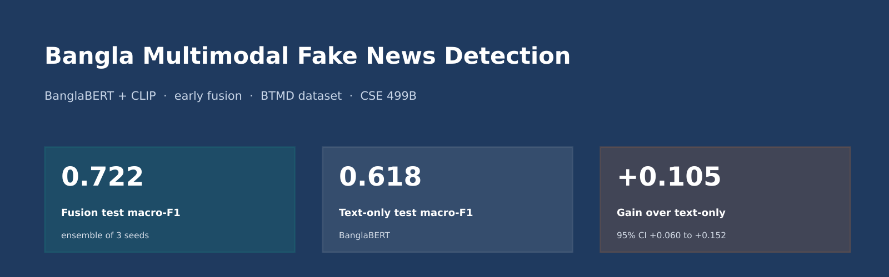
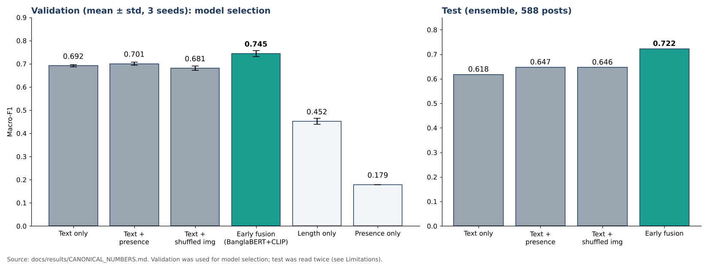
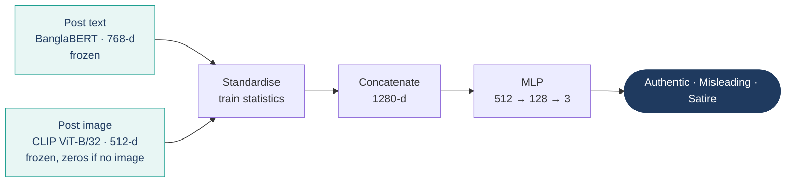
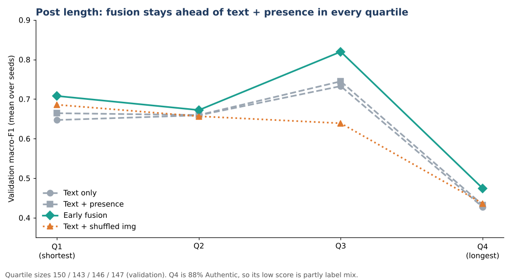

<p align="center">
  
</p>

<p align="center">
  
  
  
  
</p>

> **Research prototype, not a fact-checker.** The model predicts a dataset label from a post's text and image. It does not verify claims.

---

## At a glance

| | |
|---|---|
| **Question** | Does a post's image add information beyond its text and simple shortcuts (length, image presence)? |
| **Answer** | Yes, on the test split: early fusion of BanglaBERT and CLIP beats text-only by **+0.105** macro-F1 (95% CI **+0.060 to +0.152**). |
| **Data** | BTMD, 3,910 Bangla posts in three classes: Authentic, Misleading, Satire |
| **Caveat** | The test split was read twice, and the dataset is the only evaluation set so far. |

**Branches:** `main` holds the **CSE 499A** project (Fakeddit, XLM-RoBERTa + ResNet50). This branch holds the **CSE 499B** project.

---

## Results

<p align="center">
  
</p>

| Model | Test macro-F1 (ensemble) | Satire F1 |
|---|---:|---:|
| Text only (BanglaBERT) | 0.618 | 0.262 |
| Text + presence flag | 0.647 | 0.344 |
| Text + shuffled image | 0.646 | 0.327 |
| **Early fusion (BanglaBERT + CLIP)** | **0.722** | **0.480** |

The fusion model's per-seed mean is **0.728** (range 0.721–0.736). The ensemble score of **0.722** is the headline.

<details>
<summary><b>Paired bootstrap contrasts (fusion minus control)</b></summary>

Test macro-F1, paired bootstrap with 2,000 resamples, seed 42.

| Comparison | Difference | 95% CI |
|---|---:|---:|
| Text only → fusion | +0.105 | [+0.060, +0.152] |
| Text + presence → fusion | +0.075 | [+0.024, +0.126] |
| Text + shuffled image → fusion | +0.076 | [+0.017, +0.132] |

- The `p_b_better` value in the JSON is a resample share, **not a p-value**.
- The first contrast comes from the first test read. The others come from the second read and are not corrected for multiple comparisons.
- Satire has 32 test posts, so its intervals are wide.

</details>

---

## Method



- **Training:** AdamW (lr `1e-4`), batch 64, up to 30 epochs, early stopping (patience 5) on validation macro-F1, class-weighted cross-entropy.
- **Seeds:** 42, 43, 44. Headline numbers average the probabilities across seeds.
- **Selection:** on validation only. The test split was read for the pre-registered contrasts.

<details>
<summary><b>Validation numbers and controls</b></summary>

| Model | Validation macro-F1 |
|---|---:|
| Text only (BanglaBERT) | 0.692 ± 0.005 |
| Text + presence flag | 0.701 ± 0.006 |
| Text + shuffled image | 0.681 ± 0.009 |
| **Early fusion (BanglaBERT + CLIP)** | **0.745 ± 0.013** |
| Length only | 0.452 ± 0.013 |
| Presence only | 0.179 |

Controls exist to test whether the gain could come from something simpler: having an image at all (presence flag), any image vector (shuffled), or post length alone.

</details>

---

## Shortcut checks

<p align="center">
  
</p>

- **Length is tied to the label.** 88% of the longest validation quartile is Authentic, and 70% of Misleading posts fall in the two shortest quartiles. Length is reported as a confound, not removed.
- **The image gain holds in every length quartile.** Fusion stays above text + presence in all four.
- **Near-duplicates:** five cross-split pairs have TF-IDF cosine ≥ 0.8. All five share a label, and one involves a test row.
- **Reproducible:** a rerun in the same environment matched the saved probabilities exactly.

---

## Negative results

These were tested against pre-set criteria and did not pass. They are reported on purpose.

| Component | Result | Decision |
|---|---|---|
| Cultural features (LLM silver labels) | Failed the blind human check | Disabled |
| Evidence retrieval (Bangla Wikipedia, BM25) | Relevance below the 0.6 threshold in all three checks (0.325, 0.408, 0.225) | Display-only |
| Dense / hybrid retrieval | No gain over BM25 on dev (0.225 vs 0.242) | BM25 kept |
| OCR text from images | Pilot CER 0.599 on 14 references | Not used for any claim |

---

## Limitations

- **One dataset.** No external or source-held-out evaluation yet.
- **Small Satire class.** 193 posts in total, 32 in test.
- **Shortcut signals** (length, presence) are measured, not removed.
- **Test split read twice.** Treat the numbers as experimental findings, not a final estimate.
- **Text truncated** at 128 tokens. **Frozen encoders**; fine-tuning was not compared.
- **No human evaluation** of the explanations. Sensitivity is not truth.
- **Environment log incomplete:** GPU type, PyTorch version, and feature-file dates are not yet recorded for every run.

---

## Setup

<details>
<summary><b>1. Run the local tests (no data or GPU)</b></summary>

```bash
python -m venv .venv
source .venv/bin/activate          # Windows PowerShell: .\.venv\Scripts\Activate.ps1
pip install -r requirements.txt
PYTHONPATH=. pytest -q tests/      # Windows PowerShell: $env:PYTHONPATH="."; pytest -q tests/
```

</details>

<details>
<summary><b>2. Run the full pipeline on Google Colab</b></summary>

Keep the data outside the repository, in your own Google Drive:

```text
MyDrive/
├── Bangla-Multimodal-FakeNews/     # this repository
└── BFND-data/
    ├── data/raw/                   # BTMD table and images (you supply these)
    ├── features/                   # created by the pipeline
    └── results/                    # created by the pipeline
```

1. Open `notebooks/00_supervised_run_guide` in Colab.
2. Mount Drive and complete the input checks in the first cell.
3. Set **Runtime → Change runtime type → T4 GPU** (for feature extraction).
4. Run the notebooks and numbered scripts in their documented order.

To reproduce the reported contrasts, run scripts `08` (model selection), `10` (controls), and `12` (bootstrap). Each writes to `results/`. Do not use the test set for further tuning.

</details>

---

## Repository layout

<details>
<summary><b>Show the folder tree</b></summary>

```text
app/             Gradio app and consistency checker
configs/         paths, models, hyperparameters, BTMD schema
data_templates/  empty annotation and evidence templates
docs/
  decisions/     DECISIONS.md: research decisions D-1 to D-16
  results/       CANONICAL_NUMBERS.md: the only source for reported numbers
  roadmap/       limitation-fix plans and next-task specs
  audits/        progress audits
  figures/       images used in this README
notebooks/       Colab notebooks (see the folder for the current list)
scripts/         numbered pipeline steps 00–16 (15–16: evidence study)
src/             data, features, fusion, metrics, evidence, OCR
tests/           pure-logic tests, no GPU needed
data/            local raw and processed data (gitignored)
```

</details>

Raw data, features, checkpoints, and results are **not** committed. See `.gitignore`.

---

## Responsible use

- BTMD is used under its own licence. The dataset and images are not redistributed here.
- Predictions are research outputs. Do not use them to label real people, journalists, or organisations as fake.
- A prediction does not replace evidence review or professional fact-checking.

---

## Team

| Member | Student ID | Email |
|---|---|---|
| Anas Ahmed | 2121264042 | anas.ahmed@northsouth.edu |
| Subroto Ghosh | 2212150642 | subroto.ghosh@northsouth.edu |
| Joy Saha | 2312466042 | joy.saha1@northsouth.edu |
| Md. Abu Sufian Protik | 2312234042 | abu.protik@northsouth.edu |

**Faculty advisor:** Dr. Mohammad Shifat-E-Rabbi (MSRB), Assistant Professor, Department of Computer Science & Engineering, North South University, Dhaka.

---

<details>
<summary><b>CSE 499A (earlier project, on <code>main</code>)</b></summary>

CSE 499A explored English multimodal fake-news classification on Fakeddit, using an XLM-RoBERTa text branch and a ResNet50 image branch with late fusion, plus a Streamlit demo.

In the saved output of `CSE499A_Final.ipynb`, the test accuracies were **XLM-RoBERTa 84.83%**, **ResNet50 78.70%**, and **late fusion 78.91%**. Late fusion was therefore **5.92 points below** the text model, so it did not beat the best single modality. These are 499A results, not 499B results.

</details>
