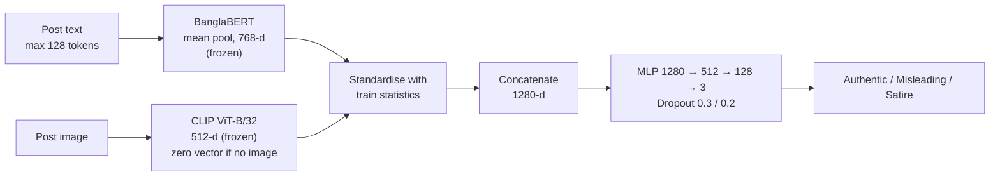

# Bangla Multimodal Fake News Detection

**CSE 499B Capstone · North South University · Department of CSE**

Text and image classification for Bangla social-media posts, built on the BTMD dataset.


-lightgrey)


> **Research prototype, not a fact-checker.** The model predicts a label from a post's text and image. It does not check whether a claim is true.

---

## Branches

| Branch | Project | Contents |
|---|---|---|
| `main` | **CSE 499A** | Earlier English multimodal project (Fakeddit; XLM-RoBERTa + ResNet50, late fusion) |
| `cse499b-capstone` | **CSE 499B** (this branch) | Bangla BTMD pipeline: BanglaBERT + CLIP, early fusion (CCEF), controls, evidence and OCR studies |

---

## Part A: CSE 499A (summary)

The 499A project used the **Fakeddit** dataset. It combined a text model (XLM-RoBERTa) and an image model (ResNet50) with late fusion, and was deployed as a Streamlit app.

- The reported figures are in the 499A report and on `main`. They are **not re-verified** in this branch.
- The 499A code is on `main`. It is not copied here.
- 499B changes the language (Bangla), the dataset (BTMD), the encoders, and the fusion method. It also adds controls for shortcut signals.

---

## Part B: CSE 499B (this branch)

### 1. Research question

Does the image add information beyond the text, and beyond simple shortcuts such as post length and image presence, when classifying Bangla posts?

### 2. Answer (short)

Yes, on the test split, with the caveats below. Early fusion of BanglaBERT and CLIP beats the text-only model and both image controls. The gain holds in the paired bootstrap. The test split was read twice, so treat this as a measured result, not a final claim.

### 3. Dataset: BTMD

| Item | Value |
|---|---|
| Source | BTMD (Bengali Trimodal Misinformation Dataset). Not redistributed here. |
| Label mapping | Real → Authentic, Misinformation → Misleading, Satire → Satire. Clickbait excluded. |
| Final size | 3,910 posts: Authentic 2,208, Misleading 1,509, Satire 193 |
| Split | Grouped by heading to prevent leakage: train 2,736 / validation 586 / test 588 (Satire: 30 validation, 32 test) |

### 4. Method



- **Early fusion (CCEF head).** Features are standardised with training statistics only, concatenated, and passed to the MLP.
- **Training.** AdamW (lr 1e-4), batch 64, up to 30 epochs, early stopping (patience 5) on validation macro-F1, class-weighted cross-entropy.
- **Seeds.** 42, 43, 44. Headline test numbers average the probabilities across seeds (ensemble).
- **Model selection.** Made on validation only (D-3). The test split was read for the pre-registered contrasts (D-8, D-10).

### 5. Controls

Every headline number is shown next to the controls that could explain it.

| Control | What it tests |
|---|---|
| Text only (BanglaBERT) | How much the text alone gives |
| Text + image-presence flag | Whether "has an image" alone explains the gain |
| Text + shuffled image | Whether the real image content matters, or any image vector does |
| Length only | Whether post length alone explains the labels |
| Presence only | Whether the image-presence flag alone works |

### 6. Results

**Validation** (mean ± std over three seeds; model selection was made here)

| Model | Validation macro-F1 |
|---|---|
| Text only (BanglaBERT) | 0.692 ± 0.005 |
| Text + presence flag | 0.701 ± 0.006 |
| Text + shuffled image | 0.681 ± 0.009 |
| **Early fusion (BanglaBERT + CLIP), selected** | **0.745 ± 0.013** |
| Length only | 0.452 ± 0.013 |
| Presence only | 0.179 |

**Test** (ensemble of three seeds; paired bootstrap, 2,000 resamples, seed 42)

| Model | Test macro-F1 | Satire F1 |
|---|---|---|
| Text only (BanglaBERT) | 0.618 | 0.262 |
| Text + presence flag | 0.647 | 0.344 |
| Text + shuffled image | 0.646 | 0.327 |
| **Early fusion (BanglaBERT + CLIP)** | **0.722** | **0.480** |

- Per-seed mean for the fusion model: **0.728** (range 0.721–0.736). The ensemble (0.722) is the headline.

**Paired differences (fusion minus control, test macro-F1)**

| Comparison | Difference | 95% CI |
|---|---|---|
| Text only → fusion | +0.105 | [+0.060, +0.152] |
| Text + presence → fusion | +0.075 | [+0.024, +0.126] |
| Text + shuffled image → fusion | +0.076 | [+0.017, +0.132] |

Notes:
- The bootstrap "p_b_better" value is a resample share, not a p-value. Do not report it as one.
- Three contrasts in the second read are not corrected for multiple comparisons.
- Satire has 32 test rows. Its intervals are wide.

### 7. Shortcut checks

- **Length is strongly tied to label.** 88% of the longest validation quartile is Authentic. 70% of Misleading posts fall in the two shortest quartiles. The length-only model (0.452) picks up a real signal. It is reported as a confound, not removed.
- **Image gain holds across length quartiles.** Fusion minus text + presence is positive in all four validation quartiles.
- **Near-duplicates.** Five cross-split pairs have TF-IDF cosine ≥ 0.8. All five share a label. One is in test (of 588 rows).
- **Reproducibility.** A rerun in the same environment reproduced the validation means, test per-seed values and saved probabilities exactly (difference 0.0).

### 8. Negative results (reported on purpose)

| Component | Result | Decision |
|---|---|---|
| Cultural features (LLM silver labels) | Failed the blind human check | Switched off (D-2, D-9) |
| Evidence retrieval (Bangla Wikipedia, BM25) | Relevance below the pre-set 0.6 threshold in three checks: 13/40 (0.325); eval 49/120 (0.408); fresh pre-registered test 27/120 (0.225) | Display-only; does not change predictions (D-4, D-5, D-13, D-15) |
| Dense / hybrid retriever | No gain over BM25 on dev (0.225 vs 0.242) | BM25 kept (D-12) |
| OCR text in images | Pilot on 14 hand-typed references: pooled character error rate 0.599 | Not used to support any claim (D-16) |

### 9. Limitations

- **One dataset.** No external or source-held-out evaluation yet.
- **Small Satire class.** 193 posts in total. Satire results are suggestive only.
- **Length and presence confounds.** Measured, not removed.
- **Test split read twice.** Stated in the report.
- **Text truncated** at 128 tokens.
- **Frozen encoders.** Fine-tuning was not compared under the same protocol.
- **Explanations** show model sensitivity, not truth. No human evaluation has been done.
- **Reproducibility record incomplete.** GPU type, torch version and feature-file date are not yet logged per run.

---

## Repository layout

```
app/                 Gradio app (capstone_app.py) and consistency checker
configs/             config.py (paths, models, hyperparameters), btmd_schema.py
data/                raw and processed data; gitignored, never committed
data_templates/      empty templates for annotation and evidence files
docs/
  decisions/         DECISIONS.md: every research decision (D-1 to D-16)
  results/           CANONICAL_NUMBERS.md: the only source for reported numbers
  roadmap/           limitation-fix plan and next-task spec
  audits/            progress audits
notebooks/           Colab notebooks: 00_supervised_run_guide, 01_preprocessing,
                     02_model_training, 03_model_selection
scripts/             numbered pipeline steps 00–16 (15 and 16: evidence study)
src/                 library code (data, features, fusion, metrics, evidence, OCR)
tests/               pytest suite (pure logic; no GPU or network needed)
```

---

## Setup

### Local tests (no data, no GPU)

```bash
python -m venv .venv
source .venv/bin/activate          # Windows: .venv\Scripts\activate
pip install -r requirements.txt
PYTHONPATH=. pytest -q tests/
```

### Full run on Google Colab

The data stays outside the repository, in your own Google Drive:

```
MyDrive/
├── Bangla-Multimodal-FakeNews/        ← this repository
└── BFND-data/
    ├── data/raw/                      ← BTMD table and images (you supply these)
    ├── features/                      ← created by the pipeline
    └── results/                       ← created by the pipeline
```

1. Open a notebook from `notebooks/` in Colab. Start with `00_supervised_run_guide`.
2. Set **Runtime → Change runtime type → T4 GPU** (needed for feature extraction only).
3. Run the cells in order. The first cell mounts Drive and checks the inputs.

### Reproducing the reported numbers

Run scripts `08` (model selection), `10` (controls) and `12` (bootstrap). Each writes to `results/`. Reported values are listed in `docs/results/CANONICAL_NUMBERS.md`.

---

## Data policy

- BTMD is used under its own licence. The raw data and images are **not** in this repository.
- Do not commit `data/`, `features/`, `checkpoints/` or `results/` (see `.gitignore`).
- Predictions are research outputs. Do not use them to label real people or publications as fake.

---

## Team

| Name | Student ID | Email |
|---|---|---|
| Anas Ahmed | 2121264042 | anas.ahmed@northsouth.edu |
| Subroto Ghosh | 2212150642 | subroto.ghosh@northsouth.edu |
| Joy Saha | 2312466042 | joy.saha1@northsouth.edu |
| Md. Abu Sufian Protik | 2312234042 | abu.protik@northsouth.edu |

**Faculty advisor:** Dr. Mohammad Shifat-E-Rabbi (MSRB), Assistant Professor, Department of Computer Science and Engineering, North South University, Dhaka, Bangladesh. rabbi.mohammad@northsouth.edu
